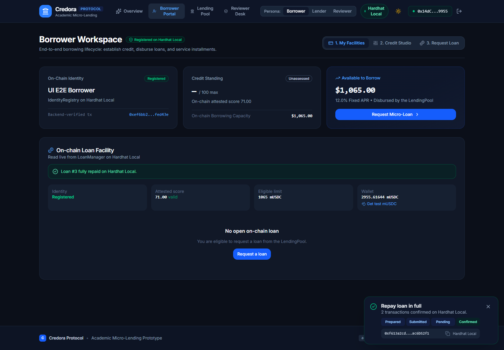
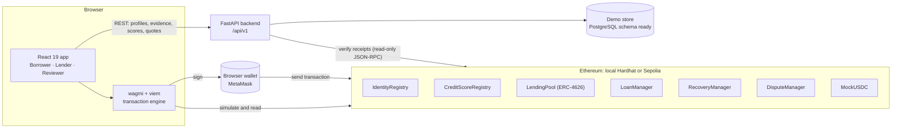
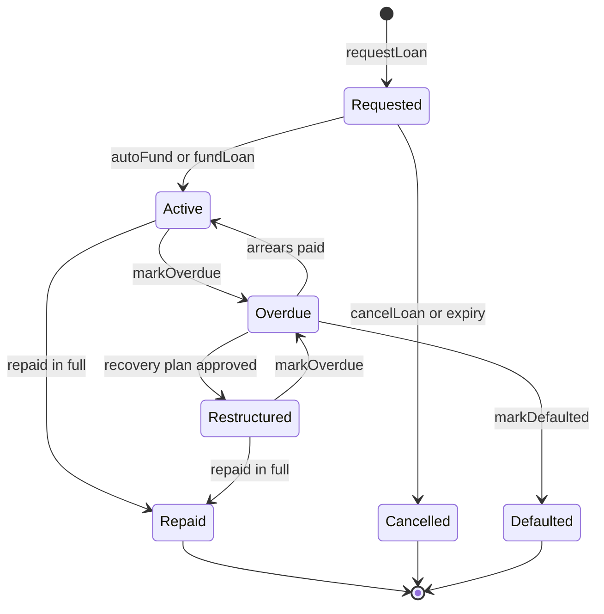
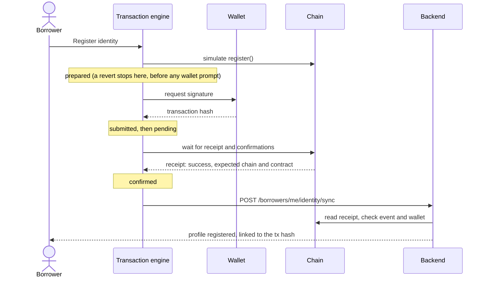
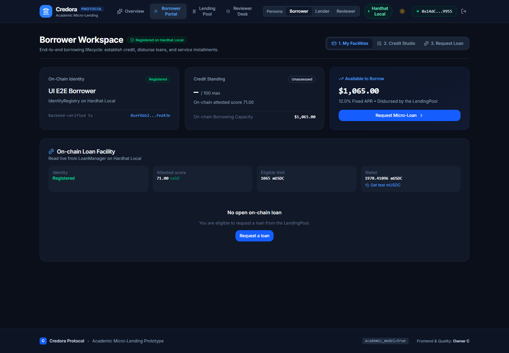
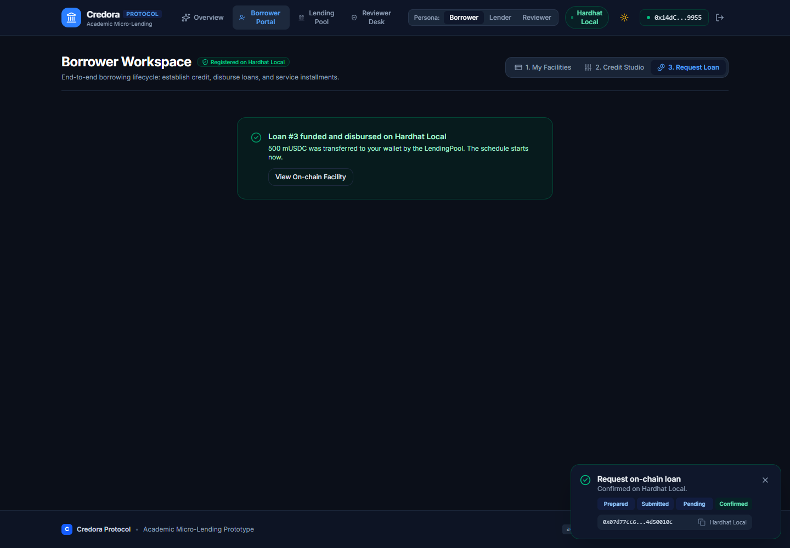
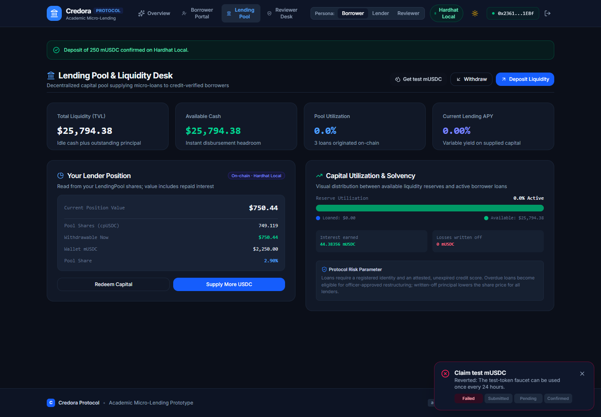
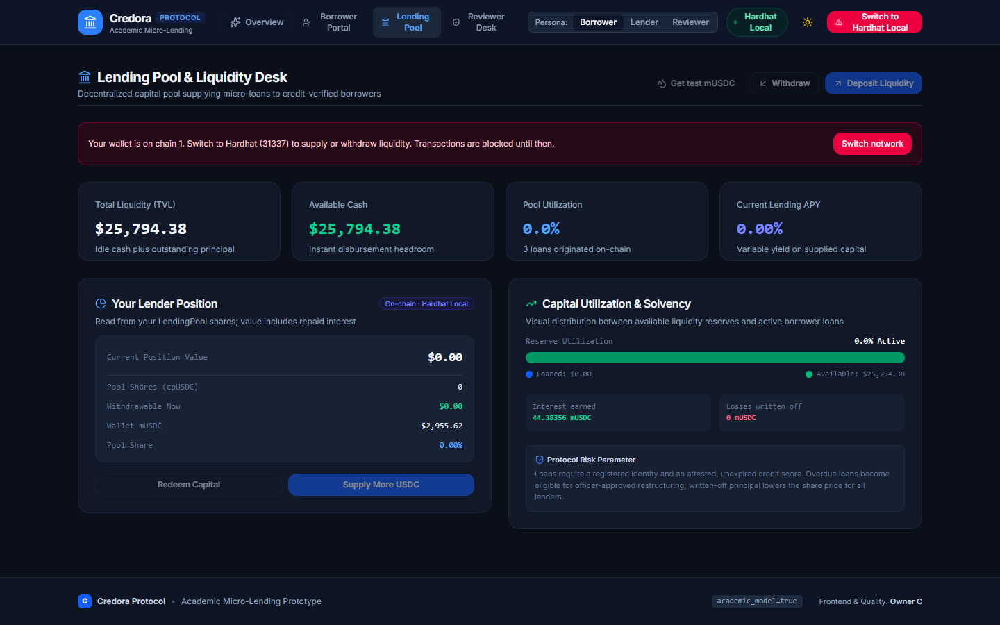
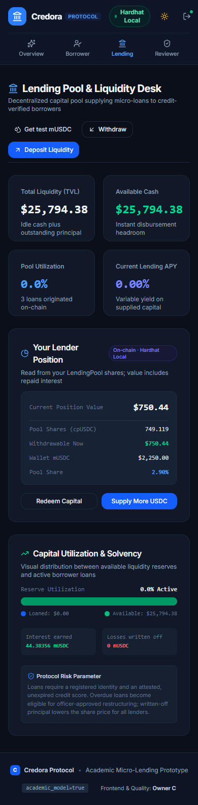

<div align="center">

# Credora · REBOUND

**Explainable, undercollateralized academic micro-lending on Ethereum.**

Borrowers build a transparent credit score from financial evidence, borrow from a shared
lending pool, and repay on a fixed schedule. Lenders earn the interest. Overdue loans get a
structured recovery path, and every score can be disputed.

[](https://github.com/shashank-tandan21/Credora/actions/workflows/ci.yml)




</div>

> [!IMPORTANT]
> **Academic prototype.** Credora is a university project. It uses a valueless test token
> (`MockUSDC`), unaudited contracts, and an illustrative scoring model that is not
> validated for real lending. It is not financial advice and must never be deployed to
> mainnet or used with real funds.

## Contents

- [Why Credora](#why-credora)
- [What you can do](#what-you-can-do)
- [Architecture](#architecture)
- [Repository layout](#repository-layout)
- [Quick start: Demo Mode](#quick-start-demo-mode)
- [Quick start: full local blockchain](#quick-start-full-local-blockchain)
- [How the numbers work](#how-the-numbers-work)
- [Smart contracts](#smart-contracts)
- [Transaction lifecycle](#transaction-lifecycle)
- [Backend API](#backend-api)
- [Testing and quality](#testing-and-quality)
- [Security and privacy](#security-and-privacy)
- [Configuration](#configuration)
- [Project status](#project-status)
- [Screenshots](#screenshots)
- [Contributors](#contributors)
- [Limitations](#limitations)
- [License](#license)

## Why Credora

Students and early-career researchers often need small, short-term bridge loans: a
delayed stipend, a conference trip, a deposit. They usually have thin credit files, so
traditional lenders either refuse them or price them as unknowns. Credora explores a
different approach:

- **Explainable scoring.** Five weighted factors, each visible with its contribution, plus
  a plain-language explanation of what helps and what limits the score.
- **Transparent rules.** Eligibility, interest, schedules, overdue status, and defaults are
  enforced by smart contracts that anyone can read.
- **Shared liquidity.** Lenders deposit into one pool and own a proportional share of
  every repayment, so no lender has to pick individual borrowers.
- **A way back.** Overdue borrowers can propose a restructuring, and an officer can approve
  a milestone plan instead of the loan going straight to default.
- **Contestable decisions.** A borrower can dispute their own score; an independent
  reviewer decides, and an upheld dispute revokes the score on-chain.

## What you can do

The app has two modes, switched from the header.

| | **Demo Mode** (default) | **On-chain mode** (Sepolia or local Hardhat) |
|---|---|---|
| Needs | Nothing (works even without the backend) | A browser wallet such as MetaMask |
| Data | Backend demo API or an in-browser demo store | Read live from the contracts |
| Actions | Simulated and clearly labelled as simulated | Real wallet transactions with receipts |

| Persona | Demo Mode | On-chain mode |
|---|---|---|
| **Borrower** | Create a profile, tune the 5-factor score in the Credit Studio, get quotes, simulate a loan and payments, file a dispute | Register identity (the backend then verifies the receipt), see on-chain eligibility and an exact quote, borrow, pay installments or repay in full, record overdue status, request restructuring, dispute the on-chain score |
| **Lender** | Simulate deposits and withdrawals, view pool statistics | Claim test mUSDC, deposit and withdraw, see pool shares, interest earned, and losses |
| **Reviewer / admin** | Review the demo dispute queue | On-chain Operations console: attest scores, fund queued loans, mark overdue or defaulted, resolve disputes, approve or reject recovery plans, complete milestones |

## Architecture



Three boundaries keep the system honest:

1. **The wallet signs everything.** The backend never holds or receives private keys; it
   only reads receipts to confirm what happened on-chain.
2. **Submitted is not success.** A transaction is shown as confirmed only after a
   successful receipt on the expected chain from the expected contract.
3. **Demo stays demo.** Simulated actions never show a transaction hash or claim to be
   on-chain, and the two modes never share state.

## Repository layout

```text
Credora/
├── backend/                 FastAPI API: auth, borrowers, evidence, scoring, loans, pool, chain verification
│   ├── app/                 routes · schemas · services · repositories · SQLAlchemy models
│   ├── migrations/          Alembic migration for the full schema
│   └── tests/               pytest suite
├── contracts/               Hardhat 3 project
│   ├── contracts/           7 Solidity contracts + interfaces
│   ├── test/                unit, validation, reentrancy, and integration tests
│   ├── scripts/             deploy · export-artifacts · smoke · verify-sepolia
│   └── deployments/         per-network manifests and ABI / event / error artifacts
├── frontend/                React 19 + Vite + Tailwind v4 app
│   ├── src/web3/            chain config, contract registry, transaction engine, hooks
│   ├── src/components/      common UI, portals, wallet and transaction components
│   └── e2e/                 browser smoke test of the on-chain UI
├── docs/                    implementation plan, manual testing guide, screenshots
└── .github/workflows/ci.yml backend, contracts, and frontend checks on every PR
```

Each package has its own detailed README:
[backend](backend/README.md) · [contracts](contracts/README.md) · [frontend](frontend/README.md).

## Quick start: Demo Mode

No blockchain, wallet, or database required. Needs **Python 3.11+** and **Node.js 22.12+**.

For this no-blockchain quick start, create `frontend/.env.local` with
`VITE_DEMO_MODE=true`. Without that setting, the frontend defaults to Hardhat Local
on-chain mode so wallet transactions use local ETH for gas.

```powershell
# Terminal 1: API on http://127.0.0.1:8000
cd backend
python -m venv .venv
.venv\Scripts\Activate.ps1
pip install -r requirements.txt
Copy-Item .env.example .env
uvicorn app.main:app --reload

# Terminal 2: app on http://localhost:3000
cd frontend
npm install
# Create .env.local with VITE_DEMO_MODE=true before starting Demo Mode.
npm run dev
```

Interactive API docs are at `http://127.0.0.1:8000/docs`. If the API is not running, the
frontend falls back to an in-browser demo store, so the UI always works.

## Quick start: full local blockchain

Run the complete stack against a local Hardhat chain: real contracts, real wallet
transactions, and backend receipt verification.

```powershell
# Terminal 1: local chain on http://127.0.0.1:8545 (chain id 31337)
cd contracts
npm install
npm run node

# Terminal 2: deploy all contracts, seed balances and 25,000 mUSDC of pool liquidity
cd contracts
npm run deploy:local
npm run smoke:local          # optional: 20 real transactions end to end
```

**Backend.** In `backend/.env`, set `SEPOLIA_RPC_URL=http://127.0.0.1:8545`,
`CHAIN_ID=31337`, and paste the seven `*_ADDRESS` lines from
`contracts/deployments/localhost.env.example`. Then start it as in Demo Mode.

**Frontend.** Create `frontend/.env.local` with:

```text
VITE_CHAIN_ID=31337
VITE_DEMO_MODE=false
```

Contract addresses default to the deterministic local deployment, and
`npm run deploy:local` also deploys a Chainlink-compatible local ETH/USD mock feed.
Run `npm run export` after deployment, then start the frontend with `npm run dev`.

**Wallet.** In MetaMask, add network `http://127.0.0.1:8545` with chain id `31337`, and
import a few accounts printed by `npm run node`. Account #0 holds every operator role
(attester, funder, reviewer, recovery officer).

> [!WARNING]
> Hardhat development keys are public. Use them only on your local chain.

A good first walkthrough:

1. **Borrower** (any account except #0): *Borrower Portal → Attest Identity On-chain.*
2. **Operator** (account #0): *Reviewer Desk → On-chain Operations → Attest score* for the borrower's address.
3. **Borrower**: *Request Loan → Request Loan On-chain.* The pool funds it in the same transaction.
4. **Borrower**: *My Facilities → Get test mUSDC*, then *Repay in full*.
5. **Lender**: *Lending Pool → Deposit Liquidity* and watch the pool's interest earned.

## How the numbers work

### Credit score (academic model)

Each factor is a normalized 0-100 value from submitted evidence; the score is the weighted
sum.

| Factor | Weight |
|---|---:|
| Repayment history | 35% |
| Affordability | 25% |
| Cash-flow stability | 15% |
| Debt burden | 15% |
| Evidence quality | 10% |

Worked example, with inputs 80 / 70 / 60 / 50 / 90:

```text
80 × 0.35 = 28.0
70 × 0.25 = 17.5
60 × 0.15 =  9.0
50 × 0.15 =  7.5
90 × 0.10 =  9.0
            ────
Score       71.0   →  "Fair"
```

| Score | Category |
|---|---|
| below 40 | High risk |
| 40 to below 60 | Moderate risk |
| 60 to below 75 | Fair |
| 75 to below 90 | Good |
| 90 and above | Strong |

Every assessment returns `academic_model: true`, the five contributions, and an
explanation naming the strongest and weakest factor.

### Loans

| Rule | Value |
|---|---|
| Eligible limit | score × 15 mUSDC, capped at 2,000 (score 71 → **1,065 mUSDC**) |
| Interest | 12% APR, simple: `principal × 1200 × days / (10000 × 365)` |
| Duration | 30 to 365 days |
| Installments | `ceil(days / 30)`, due every 30 days from funding |
| Rounding | each installment is `floor(total / count)`; the final one absorbs the remainder |
| Repayment order | interest first, then principal |
| Grace period | 3 days after each due date, then the loan can be marked overdue |
| Default | 60 days after the final due date; unrepaid principal becomes a pool loss |

Example: **500 mUSDC for 90 days** costs `14.794520` mUSDC of interest (rounded down to
6 decimals on-chain; the backend quote shows `14.79`), repaid as 3 installments of
`171.598173`, `171.598173`, and `171.598174`. On-chain amounts are authoritative for
settlement.

### Lender returns

The pool is an ERC-4626 vault. Deposits mint `cpUSDC` shares. Repaid interest raises the
value of every share, and written-off principal lowers it. Withdrawals are limited to idle
cash, so funds lent out stay with borrowers until they are repaid.

## Smart contracts

| Contract | Role | Local address (fresh `deploy:local`) |
|---|---|---|
| `MockUSDC` | 6-decimal test token; bounded minting and a faucet of 1,000 per day | `0x5FbDB2315678afecb367f032d93F642f64180aa3` |
| `IdentityRegistry` | Borrower self-registration with a profile hash | `0xe7f1725E7734CE288F8367e1Bb143E90bb3F0512` |
| `CreditScoreRegistry` | Expiring, versioned score attestations | `0x9fE46736679d2D9a65F0992F2272dE9f3c7fa6e0` |
| `LendingPool` | ERC-4626 pool: deposits, shares, disbursement, repayments, losses | `0xCf7Ed3AccA5a467e9e704C703E8D87F634fB0Fc9` |
| `LoanManager` | Loan lifecycle and eligibility enforcement | `0xDc64a140Aa3E981100a9becA4E685f962f0cF6C9` |
| `RecoveryManager` | Restructuring requests and milestone plans | `0x5FC8d32690cc91D4c39d9d3abcBD16989F875707` |
| `DisputeManager` | Score disputes resolved by reviewers | `0x0165878A594ca255338adfa4d48449f69242Eb8F` |

Addresses are deterministic on a fresh node. Sepolia addresses will be published in
`contracts/deployments/sepolia.json` once deployed.

### Loan lifecycle



### Design highlights

- **Non-upgradeable** contracts using OpenZeppelin AccessControl, Pausable,
  ReentrancyGuard, and SafeERC20, with custom errors throughout.
- **Least privilege.** Only the LoanManager can move pool funds, only the RecoveryManager
  can restructure loans, and only the DisputeManager can revoke disputed scores.
- **Conflict-of-interest rules on-chain.** Attesters cannot score themselves, reviewers
  cannot resolve their own disputes, and officers cannot approve their own recovery.
- **Manipulation-resistant pool.** `totalAssets()` uses internal accounting, so tokens sent
  directly to the pool cannot move the share price.
- **Borrower-safe pausing.** Pausing stops new risk (deposits, loans, attestations), but
  repayments always go through.
- **Fully event-sourced.** Every state change emits ids, addresses, amounts, and a
  timestamp. The pool's cash can be rebuilt exactly from its events, and a test proves it.
- **No personal data on-chain.** Profiles, dispute reasons, and decision notes are
  referenced only by `keccak256` hash.

The complete reference (every function, event, custom error, role, and the pause matrix) is in
[contracts/README.md](contracts/README.md).

## Transaction lifecycle

Every wallet action goes through one engine with explicit states, shown in a panel at the
bottom right of the app.



| Outcome | What the user sees |
|---|---|
| Rejected in wallet | **Failed: Rejected in wallet**. Nothing was submitted. |
| Contract revert | **Failed: Reverted**, with the custom error translated (for example "once every 24 hours"). |
| No receipt in time | **Failed: Timed out**, with the hash kept so it can be checked before retrying. |
| Cancelled or replaced | **Failed**, even if the replacement transaction succeeded. Sped-up transactions are followed. |
| Wallet on the wrong network | Actions blocked, with a one-click switch. |

Sepolia waits for 2 confirmations to absorb shallow reorganizations; the local chain
waits for 1.

## Backend API

All routes are under `/api/v1`. Authenticated routes use a bearer token from the wallet
nonce flow.

| Area | Endpoints |
|---|---|
| Health | `GET /health` · `GET /health/readiness` |
| Auth | `POST /auth/nonce` · `POST /auth/verify` |
| Borrowers | `POST /borrowers/register` · `GET /borrowers/me` · `POST /borrowers/me/identity/sync` |
| Credit | `POST /credit/evidence` · `GET /credit/evidence` · `POST /credit/assess` · `GET /credit/current` · `GET /credit/history` |
| Loans | `POST /loans/quote` · `POST /loans` · `GET /loans` |
| Pool | `GET /pool/statistics` |
| Chain | `GET /chain/config` |

`/borrowers/me/identity/sync` marks a profile registered only after verifying the
`IdentityRegistered` receipt for the caller's wallet: `200` verified (repeating the same
hash is idempotent), `409` pending or a different hash already linked, `422` failed or
mismatched receipt, `503` chain not configured or RPC unavailable.

A copy-paste PowerShell walkthrough of every endpoint is in
[docs/manual-testing.md](docs/manual-testing.md).

## Testing and quality

| Suite | Command | Result |
|---|---|---|
| Contracts: unit, validation, reentrancy, integration | `cd contracts && npm test` | **97 passing** |
| Contracts: coverage | `npm run coverage` | **97.6% lines** (threshold 95%) |
| Contracts: end-to-end smoke | `npm run smoke:local` | **20 confirmed transactions** |
| Backend | `cd backend && python -m pytest -q` | **29 passed** |
| Frontend: unit | `cd frontend && npm test` | **27 passed** |
| Frontend: engine vs. local chain | `npm run test:e2e:local` | **3 passed** |
| Frontend: browser smoke of the on-chain UI | `npm run test:browser:local` | **11/11 steps** |
| Frontend: typecheck, lint, build | `npm run typecheck` · `npm run lint` · `npm run build` | passing |

Highlights:

- A malicious token that re-enters the pool proves the reentrancy guards hold.
- An integration test rebuilds the pool's cash from emitted events and matches it exactly, to the smallest token unit.
- The browser smoke test drives the real UI in Edge or Chrome with an injected wallet
  provider. It covers connecting, identity registration with backend verification,
  borrowing, repayment, deposits, a revert shown as failed, Demo Mode labelling,
  phone-width layout, and the wrong-network block.

**CI** runs on every pull request: backend tests and compile check; contracts typecheck,
coverage, and a check that the generated ABIs and event topics match the contracts; and
frontend typecheck, lint, unit tests, and production build.

## Security and privacy

- No private keys in code, config, the frontend bundle, or the backend. Sepolia secrets
  live in environment variables or Hardhat's encrypted keystore.
- `npm run deploy:sepolia` runs the full test suite before any testnet transaction, and
  the deploy script refuses every chain except Hardhat and Sepolia.
- The backend never returns or logs the RPC URL, which may contain an API key.
- Token approvals are for exact amounts, never unlimited.
- Amounts are parsed straight to integer units, never through floating point.
- Contract roles are separable (`OPERATOR_ADDRESS`); in any real deployment the admin
  should be a multisig.
- Threat assumptions (wallet compromise, malicious evidence, replays, RPC failure) are
  documented in the [contracts README](contracts/README.md#threat-assumptions-and-limitations).

## Configuration

| Package | Key variables | Reference |
|---|---|---|
| Backend | `DEMO_MODE`, `DATABASE_URL`, `JWT_SECRET`, `SEPOLIA_RPC_URL`, `CHAIN_ID`, `CHAIN_CONFIRMATIONS`, `*_ADDRESS` | [backend/.env.example](backend/.env.example) |
| Frontend | `VITE_API_URL`, `VITE_CHAIN_ID`, `VITE_DEMO_MODE`, `VITE_RPC_URL`, `VITE_CONFIRMATIONS`, `VITE_*_ADDRESS` | [frontend/.env.example](frontend/.env.example) |
| Contracts | `SEPOLIA_RPC_URL`, `SEPOLIA_DEPLOYER_PRIVATE_KEY`, `ETHERSCAN_API_KEY`, `OPERATOR_ADDRESS` | [contracts/README.md](contracts/README.md#sepolia-deployment-phase-11) |

With `DEMO_MODE=false`, the backend refuses to start unless PostgreSQL, a changed JWT
secret, the RPC URL, a supported chain id, and all seven contract addresses are configured.

## Project status

Tracked in detail in the [implementation plan](docs/PR-2-DAY-IMPLEMENTATION-PLAN.md).

| Area | Status |
|---|---|
| Backend API, scoring, loans, demo store | ✅ Working |
| Persistence (Alembic schema, repositories) | 🟡 Schema and repositories ready; services still use the demo store |
| Frontend portals and design system | ✅ Working |
| Smart contracts (7) with tests | ✅ Complete |
| Local deployment and smoke test | ✅ Complete |
| Wallet integration and transaction lifecycle | ✅ Complete |
| Backend chain verification | 🟡 Identity receipts verified; loan, repayment, and pool events not yet synced |
| Wallet sign-in (EIP-4361) | 🟡 Demo signature only |
| Repayment, recovery, and dispute APIs | ⏳ Planned (on-chain flows already work) |
| Sepolia deployment | ⏳ Scripts ready; waiting for a funded testnet deployer |

## Screenshots

| Identity registered and verified | Loan funded on-chain |
|---|---|
|  |  |
| **A revert is reported as failed** | **Wrong network is blocked** |
|  |  |

<p align="center">
  
</p>

## Contributors

The work is split into three workstreams, each owning its acceptance criteria in the
implementation plan.

| Workstream | Scope | Contributor (from commit history) |
|---|---|---|
| A: Backend and data | FastAPI, scoring, persistence, repayments, recovery and dispute APIs | shashank-tandan |
| B: Blockchain and Web3 | Solidity contracts, Hardhat, deployments, wallet integration, transaction lifecycle, chain verification | skypank |
| C: Frontend and quality | React UI, design system, typed API client, accessibility, QA | Gadekar1116 |

## Limitations

Kept visible on purpose, as the project plan requires:

- Not for production lending, real funds, or real credit decisions; the model is
  illustrative and the score inputs are self-supplied, normalized demo values.
- No real credit-bureau data, KYC, or AML.
- Contracts are unaudited and have only run on a local chain so far.
- Demo data lives in memory and resets when the API restarts.
- Score attestations are published by an operator wallet rather than automatically from
  backend assessments, because the backend must never hold a signing key.
- Overdue and recovery flows need time to pass, so they are exercised on the local chain
  (with time travel), not on public testnets.

## License

[MIT](LICENSE) © 2026 Shashank Tandan.

Built with [OpenZeppelin Contracts](https://www.openzeppelin.com/contracts),
[Hardhat](https://hardhat.org), [wagmi](https://wagmi.sh), [viem](https://viem.sh),
[FastAPI](https://fastapi.tiangolo.com), [React](https://react.dev),
[Vite](https://vite.dev), and [Tailwind CSS](https://tailwindcss.com).
